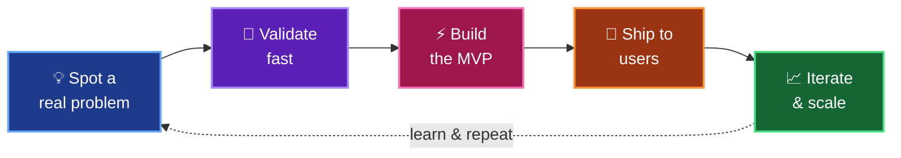
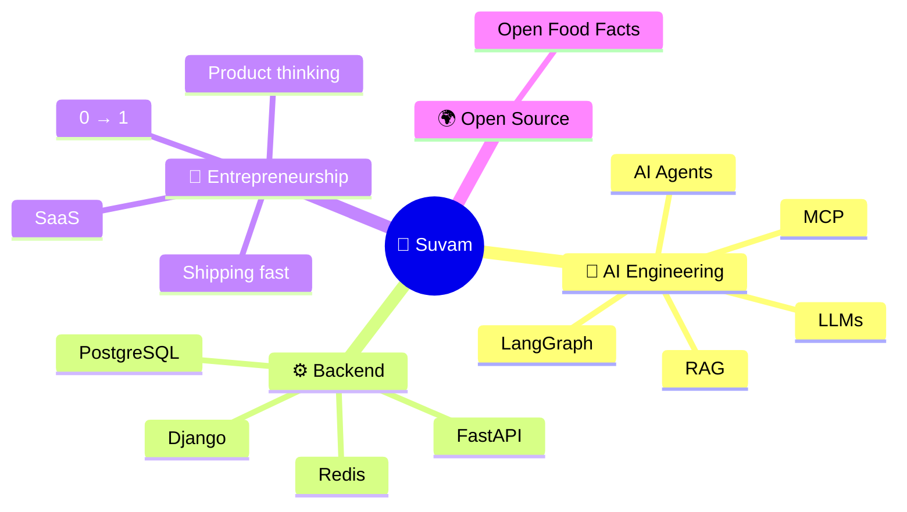

<!-- ===================== HEADER ===================== -->
<p align="center">
  
</p>

<p align="center">
  <a href="https://github.com/suvammpatra">
    
  </a>
</p>

<p align="center">
  
  <a href="https://github.com/suvammpatra?tab=followers"></a>
  
  
</p>

---

<!-- ===================== ABOUT ===================== -->
## 👨‍💻 About Me

I'm an **AI/ML Engineer at Polluxa**, building production-ready AI agents and intelligent automation — including AI-powered sales automation and CRM workflow systems.

But at heart, **I'm an entrepreneur.** 🚀 I don't just write code — I hunt for problems worth solving, turn them into products, and ship them to real people. Startups, SaaS, and building from zero are what drive me.

I also contribute to open source through **[Open Food Facts](https://github.com/openfoodfacts)** 🍎.

> [!TIP]
> **Currently:** building AI agents & automation at Polluxa · **Exploring:** multi-agent systems & MCP · **Open to:** AI, SaaS & startup collabs

```python
class SuvamPatra(Engineer, Entrepreneur):

    role          = "AI/ML Engineer @ Polluxa"
    builds        = ["AI agents", "Sales automation", "CRM workflows"]
    exploring     = ["Agentic AI", "MCP", "Multi-agent systems"]
    obsessed_with = ["Startups", "SaaS", "Product-market fit"]
    open_source   = ["Open Food Facts"]

    def see(self, problem: str) -> str:
        return f"💡 {problem} → opportunity → product → 🚀"

    @property
    def motto(self):
        return "Build. Ship. Learn. Repeat."
```

---

<!-- ===================== FOUNDER MINDSET ===================== -->
## 🧠 How I Build — The Founder Loop



> [!IMPORTANT]
> *"I turn ideas into products, build startups, and believe every problem is a business opportunity."*

---

<!-- ===================== MY WORLD ===================== -->
## 🌌 My World



---

<!-- ===================== TECH STACK ===================== -->
## 🛠️ Arsenal

<table align="center">
  <tr>
    <td align="center"><b>💻 Languages</b></td>
    <td></td>
  </tr>
  <tr>
    <td align="center"><b>🧠 AI / ML</b></td>
    <td></td>
  </tr>
  <tr>
    <td align="center"><b>⚙️ Frameworks</b></td>
    <td></td>
  </tr>
  <tr>
    <td align="center"><b>🗄️ Data & Infra</b></td>
    <td></td>
  </tr>
</table>

<p align="center">
  
  
  
  
  
  
  
  
  
</p>

---

<!-- ===================== STREAK ===================== -->
## 🔥 Consistency

<p align="center">
  
</p>

---

<!-- ===================== RULES ===================== -->
## 📜 My Builder Rules

```diff
+ Problems are just startup ideas in disguise
+ Ship it, then make it better
+ Talk to users more than you talk about users
+ Automate everything that repeats
- Waiting for the "perfect" idea
- Building in silence for a year
- Over-engineering before product-market fit
```

<details>
  <summary><b>🎲 Fun facts about me (click to open)</b></summary>
  <br/>

  - 🧩 I see bugs as puzzles and problems as business ideas
  - 🌙 My best ideas show up way past midnight
  - 📚 Always learning — currently deep into multi-agent systems & MCP
  - 🤝 I love meeting fellow builders, founders & indie hackers

</details>

---

<!-- ===================== CONNECT ===================== -->
## 🤝 Let's Build Something Together

<p align="center">
  <b>Got a startup idea, an AI problem, or just want to talk SaaS? My inbox is always open.</b>
</p>

<p align="center">
  <a href="https://www.linkedin.com/in/suvam-patra-in"></a>
  <a href="https://twitter.com/5uvampatra"></a>
  <a href="mailto:officialsuvampatra@gmail.com"></a>
  <a href="https://github.com/suvammpatra"></a>
</p>

<p align="center">
  
</p>

<!-- ===================== FOOTER ===================== -->
<p align="center">
  
</p>
